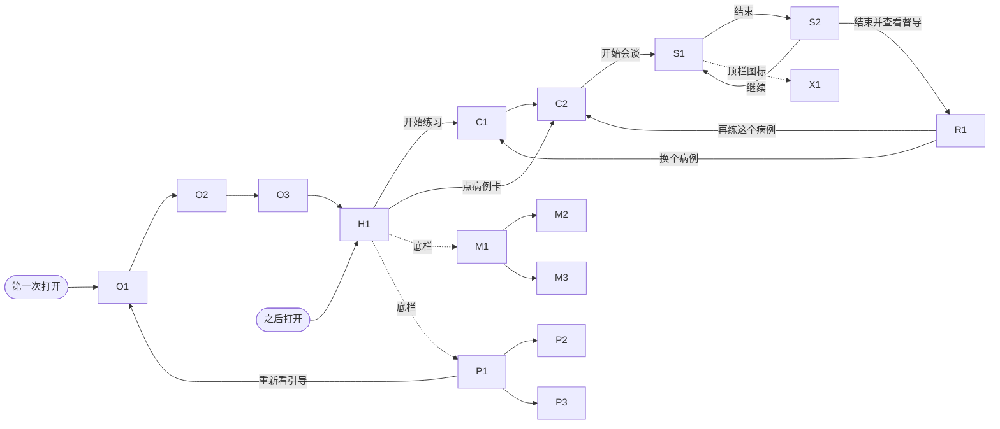

# 页面地图和导航

## 全部页面

**批次**（只排实现顺序，见 [roadmap.md](./roadmap.md)）：🟢 第 1 批 demo 必经；🔵 第 2 批 demo 前其余；🟠 第 3 批已定的新功能；🟣 等督导标准；⚪ 完整版。

| 编号 | 页面 | 批次 | 一句话 |
|------|------|------|--------|
| O1 | 欢迎 | 🟢 | 这是什么，怎么练（三步）。 |
| O2 | 先说清楚 | 🟢 | 不是治疗；对话去哪；不要输入真实信息。必须勾选同意。 |
| O3 | 准备开始 | 🟢 | 选语言、填邀请码（可跳过）。替代现在首页的邀请码弹窗。 |
| O4 | 关于你 | 🟠 D6 | 身份、经验、想练什么。可跳过，只存本机，用来推荐病例。 |
| H1 | 首页 | 🟢 | 开始练习、病例卡、声明短版。等 D3：练习目标、最近练习。 |
| C1 | 病例库 | 🟢（标签 🔵） | 所有病例，卡片列表。 |
| C2 | 病例简介 | 🟢 | 来访者是谁、这次练什么、内容提示。替代练习前声明弹窗。 |
| S1 | 会谈 | 🟢 | 和 AI 来访者对话。 |
| S2 | 结束会谈 | 🟢 | 底部弹层：结束并查看督导 / 继续会谈。 |
| R1 | 督导报告 | 🟢（条目样式 🔵） | 三部分。再练这个病例 / 换个病例。 |
| X1 | 需要帮助？ | 🟢 | 危机求助信息。不需要网络。 |
| P1 | 我的 | 🟢 | 设置（语言、邀请码、练习记录开关和删除）、关于你、帮助入口。 |
| P2 | 关于 | 🔵 | 开源、版本、团队、反馈渠道。 |
| P3 | 隐私说明 | 🟢 | 数据去哪、存在哪、怎么删。 |
| M1 | 练习记录 | 🟢 | 本机存的每一场。 |
| M2 | 单场回看 | 🟢（原话跳转 🟠） | 一场的对话 + 报告；删除。 |
| M3 | 技能进度 | 🟣 D3、D5（等督导标准） | 按督导要点看变化。 |
| T1 | 专项训练 | ⚪ | 按技术挑一项来练。 |
| T2 | 专项训练会谈 | ⚪ | 短会谈 + 即时小反馈。 |

- 🟢 第 1 批一共 14 屏：O1–O3、H1、C1、C2、S1、S2、R1、X1、P1、P3、M1、M2。
- 加上 🔵、🟠 和 🟣，一共 18 屏，外加错误和空状态。

D1–D7 的决定见 [open-decisions.md](./open-decisions.md)；除 D5 等督导标准外都已定。

## 导航

### 主线

从第 1 批起，三个顶层页带同一个底栏：练习 / 记录 / 我的。首页没有设置齿轮。

| 标签 | 根页面 | 说明 |
|------|--------|------|
| 练习 | H1 | 首页、病例库、简介、会谈、报告。 |
| 记录 | M1 | 练习记录、单场回看。M3 做好后顶部加「记录 | 进度」切换。 |
| 我的 | P1 | 设置、关于你、需要帮助？、隐私说明、关于、重新看引导。 |

- 只有顶层页（H1、M1、P1）显示底栏。流程页不显示：引导（O1–O4）、病例库和简介（C1、C2）、会谈（S1、S2）、报告（R1）、单场回看（M2）、需要帮助（X1）、关于和隐私（P2、P3）。
- 图标：练习 = 对话气泡，记录 = 文档，我的 = 人像。
- 「需要帮助？」：会谈页和报告页顶栏常驻图标；首页、病例简介底部各有一行文字链接；「我的」里也有。
- 返回：会谈页按返回 = 打开 S2，不直接离开。
- 报告还在生成时离开：提示「报告还没写完，离开就看不到了」；以后可以改为「报告会在后台写完，存到练习记录」——技术成本待定。

### 完整版

「练习」标签里，首页分两块：「完整会谈」（C1）和「专项训练」（T1）。

## 第一次打开 vs 之后打开

- 第一次：O1 → O2 → O3 → H1（第 3 批做 O4 时，O3 后加 O4）。
- 之后：直接 H1。
- O2 的确认和声明版本号存本机。声明有实质改动时（版本号变了），下次打开重新弹 O2。
- 「我的」里「重新看引导」：从 O1 走一遍，不清除任何数据。
- 技术提示：起始页由「是否完成引导」决定；现在首页上的邀请码弹窗挪进 O3。
