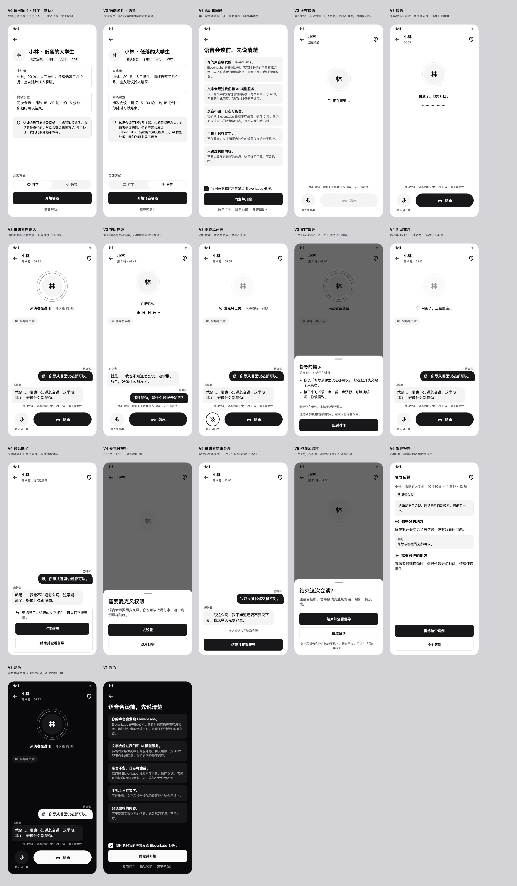

# 语音会谈设计（给开发的规格）

**状态：** 设计稿 2026-10-30，待用户确认。标「待核对」的文案在核对之前不能上线。

**一句话：** 咨询师选「语音」，同意一次，然后像打电话一样和 AI 来访者说话，可以打断，随时看转写和督导提示，结束后照旧出督导报告。

**事实来源：** [ADR 0013](https://github.com/Novawerk/project-psygym-workspace/blob/spike/elevenlabs-voice/docs/decisions/0013-voice-elevenlabs.md)（在 `spike/elevenlabs-voice` 分支，合并后路径是 `docs/decisions/0013-voice-elevenlabs.md`）、同分支的 `api-contract.md` 和 `apps/api/scripts/voice-test/index.html`。视觉沿用 [screens.md](./screens.md)「通用」和 `Theme.kt`。

**设计稿：** 画布 <https://claude.ai/artifact/T45X7MHd59Zh82us1SXgbK>（内部链接，需要分享后才能打开）。不用登录也能看的版本是 [`voice-session-design/board.png`](./voice-session-design/board.png)，源文件是同目录的 `frames.html`。稿子按 `Theme.kt` 的色值手写，没有用 Stitch（这次没有登录）。



---

## 1. 定了什么

| # | 决定 | 为什么 |
|---|------|--------|
| V-1 | 入口是 C2 主按钮上方的分段控件「打字 / 语音」。C1 和首页不加入口。 | 一页只有一个主按钮（principles §5）。模式记在本机。 |
| V-2 | 同意只问一次，按版本。C2 的内容提示每次都写声音去哪。 | 单独同意满足 Apple 5.1.2(i)，又不让每场多一页。 |
| V-3 | 通话页上面是来访者状态，下面是滚动转写。 | 听着说话时也能回看对方原话。备选是默认收起转写的纯通话页，更像真实会谈；等内测有反馈再说。 |
| V-4 | 结束键**不用红色**，用主按钮色。 | screens.md：红色只用于真正的错误。 |
| V-5 | 只有两个通话状态：来访者在说话、在听你说。**没有「来访者在想」。** | SDK 的 `onModeChange` 只有 `speaking` 和 `listening`。咨询师的转写也是一轮结束才到，所以没有实时字幕。 |
| V-6 | 通话断了不重拨，**转成打字继续**。 | ElevenLabs 的新通话没有上文，重拨就是另一场。`/chat` 每轮收整段对话，转写直接接得上。 |
| V-7 | 切到后台、接电话、打开「需要帮助」，通话都挂断，进 V4。 | 求助时不能还有来访者的声音（principles §1）。也不用申请后台录音，审核风险小。 |
| V-8 | 来访者结束会谈时不自动跳报告，沿用 S1 的系统行和主按钮。 | 被来访者结束本身是要消化的一刻。 |
| V-9 | 打开 S2 时自动关麦，「继续会谈」恢复到原来的状态。 | 咨询师犹豫时说的话不该变成一轮。 |
| V-10 | 通话页底部常驻一行「练习会谈 · 虚构的来访者由 AI 扮演 · 这不是治疗」。 | 通话的沉浸感比打字强，这句不能只在开始前说。 |

---

## 2. 流程

```text
C2 选「语音」→ 开始语音会谈
  ├─ 没同意过当前版本 → V1 → 同意并开始
  ├─ 麦克风未授权 → 系统弹框 ─ 拒绝 → V4 权限弹层（去设置 / 改用打字）
  └─ V2 正在接通 ─ 失败 → 重试 / 改用打字
       └─ V3 通话 ─ 咨询师结束 → S2 → R1
                  ├─ 来访者结束 → V5 → R1
                  ├─ 到达 80 条 → V5 → R1
                  └─ 断线 / 后台 / 需要帮助 → V4 → 打字继续（S1）或结束并查看督导（R1）
```

---

## 3. 逐屏

颜色都用 `MaterialTheme.colorScheme`，不新增颜色。边距 20，圆角沿用 `PsygymShapes`。

### V0 · 病例简介（改 C2）

- `BottomActions` 里，主按钮上方加小字「会谈方式」和 `PillToggle(fill = true)`：打字（键盘图标）｜语音（麦克风图标）。默认打字，之后记住上次选的，只存本机。
- 选语音时：
  - 主按钮文案换成「开始语音会谈」。
  - 内容提示最后一句换成 `brief_content_note_voice`。病例有自己的 `contentNotes` 时，在后面追加 `brief_voice_note`。
- 语音不可用时（见第 8 节 Q1），整个控件不显示，页面和现在完全一样。

### V1 · 说明和同意（新页面）

- 顶栏只有返回。标题 `headlineSmall`。五张 `GrayCard`，和 O2 同一种样式，一屏放不下时滚动。
- 底部固定：勾选框、主按钮、三个 `UnderlinedLink`（改用打字、隐私说明、需要帮助？）。
- 没勾选时主按钮不可点。
- 同意后本机存 `voiceConsentVersion`。第 5 节 V1 的文案有实质改动时升版本，用户下次选语音时重新确认。
- 「改用打字」：回到 C2，模式切回打字。
- 第一次语音会谈才出现，引导页不加这一页。

### V2 · 正在接通

- 顺序：`POST /voice/session` → 用 token 开 WebRTC。
- 布局同 V3，但圆环只有一圈，慢慢呼吸；没有转写；「结束」不可点。
- 返回键直接回 C2，不弹 S2，因为还没开始。
- 15 秒没接通算失败。失败时在页面中间放一张 `ErrorCard`：`voice_connect_failed`，主按钮「重试」，次按钮「改用打字」。`401`、`429` 用 screens.md 的通用文案。

### V3 · 通话中

从上到下：

| 区域 | 高度 | 内容 |
|------|------|------|
| 顶栏 | 56 | 返回（打开 S2）；化名和「第 6 轮 · 08:32」（点一下隐藏计时，同 S1）；需要帮助。**不放「结束」文字按钮**，它在底部 |
| 状态区 | 206 | 头像圆 84，外面两圈圆环，总宽 128。下面一行状态。在听时再下面一条波形 |
| 督导 Chip | 40 | 复用 `LiveChip` |
| 转写 | 占满剩下的 | 复用 `Bubble`，贴底，自动滚到最新。用户往上翻时不抢滚动 |
| 声明行 | — | `voice_practice_line`，`labelSmall`，居中，次要文字色 |
| 控制区 | 约 96 | 上边 1dp 分隔线。左：麦克风圆钮 56，下面一行小字。右：结束，高 56 全圆角，主按钮色，图标加「结束」 |

**状态**

| 状态 | 什么时候 | 状态行 | 圆环 |
|------|----------|--------|------|
| 刚接通 | 接通后第一句之前 | 接通了。你先开口。 | 一圈，波形静止 |
| 来访者在说话 | `mode = speaking` | 来访者在说话 · 可以随时打断 | 两圈，跟随输出音量 |
| 在听你说 | `mode = listening`，麦克风开 | 在听你说 | 一圈，波形跟随麦克风音量 |
| 麦克风已关 | 用户关麦 | 麦克风已关 · 来访者听不到你 | 一圈，整体 45% 透明度 |
| 重连中 | 见 V4 | 网断了，正在重连… | 同上，加转圈 |

**转写规则**

- SDK 的 `onMessage` 一次给一整段。收到就上屏，整段 150ms 淡入，不做逐字效果。
- 同一边连续两段合成一个气泡（后端 `/voice/llm` 也这样合并）。
- 咨询师沉默 6 秒时，ElevenLabs 会发 `...` 当作这一轮。**这种内容不显示、不算轮数、不进 `/supervision`。**
- 长按气泡的菜单同 S1。

**实时督导**

- 出现条件同 [live-supervision.md](./live-supervision.md)：3 轮后、设置开着、会谈没结束。
- S1 的规则是来访者回复时 Chip 变灰。语音里来访者一说就是一大段，所以改成：**只在 V2 和 V4 变灰**，来访者说话时也能点。
- 弹层不打断通话，麦克风状态不变。正文上方多一行 `voice_live_note`。其余不变：最多 5 次，不存，新的替换旧的。

**接近上限**

- 第 70 条消息起，声明行换成 `practice_near_limit`。
- 到 80 条：等来访者这句说完，App 挂断，显示 `practice_limit_reached` 和「结束并查看督导」。

### V4 · 异常

| 情况 | 表现 | 操作 |
|------|------|------|
| 网络抖动，SDK 在重连 | 转写和按钮都留着，状态行换成「网断了，正在重连…」 | 「结束」仍可点。最多等 15 秒 |
| 通话断了（重连失败、出错） | 控制区换成卡片：`voice_dropped` | 「打字继续」「结束并查看督导」 |
| 切后台、来电、点「需要帮助」 | 马上挂断。回来时显示同一张卡片，文案换成 `voice_left` | 同上 |
| 还没说过话就断了 | 回到 V2 的失败卡片 | 重试、改用打字 |
| 麦克风被拒绝 | 底部弹层，见设计稿 | 「去设置」「改用打字」 |
| 通话中被收回权限 | 按「通话断了」处理 | 同上 |

**打字继续：** 把转写当作 `ChatItem` 放进 S1，轮数和计时接着走。最后一条是咨询师的话时，自动发一次 `/chat`（和重试一样）；是来访者的话时，光标停在输入框。这一场不再回到语音。报告仍标「语音会谈」。

### V5 · 结束

**来访者结束：** `onDisconnect` 的 `reason = agent`。

- 结束语说完才挂断，这由 `end_call` 保证。
- 状态区收起，转写占满。最后一个气泡下面是 `practice_client_ended`，底部换成全宽主按钮「结束并查看督导」。
- 顶栏保留「需要帮助」，返回打开 S2。
- 一次中等触感。不放提示音。

**咨询师结束：** 点「结束」或返回，打开 S2，关麦。正文用 `voice_end_body`，小字用 `voice_end_note`（保存开关关着时用 `voice_end_note_off`）。选「结束并查看督导」后挂断。还没说话时走「离开这次练习？」。

### V6 · 督导报告

R1 不变，`/supervision` 不变。只加两处：

- 头部下面一个「语音会谈」标签，和一块浅灰提示 `voice_report_note`。
- M1、M2 同样显示这个标签。`SessionMeta` 要多记一个会谈方式。

### 「我的」和 P3

- P1「帮助」组加一行「语音会谈的声音去哪」，打开 P3 对应的问答。同意过时再加一行「撤回语音会谈的同意」：清掉本机的 `voiceConsentVersion`，下次选语音时重新出现 V1。
- P3 加两问（第 5 节）。现有的「按住说话会上传我的声音吗？」只讲按住说话，保留。

---

## 4. 动效

| 什么 | 怎么动 |
|------|--------|
| 来访者说话的圆环 | 外圈 scale `0.84 + 0.24 × 音量`，内圈 `0.72 + 0.16 × 音量`。低通平滑 120ms。没有音量回调时，用 1600ms 的循环呼吸代替 |
| 在听时的波形 | 复用 `VoiceComposer.kt` 的细波形 |
| 接通中 | 一圈 scale 0.76→0.9，1200ms 往返 |
| 状态切换 | 文字 150ms 淡入淡出，圆环 200ms 过渡 |
| 新转写 | 150ms 淡入，跟随滚动 |
| 状态区收起（来访者结束） | 高度 250ms，`FastOutSlowIn` |
| 触感 | 接通一次轻触感，来访者结束一次中等触感。关麦时轻触感 |

系统「减弱动态效果」打开时：圆环不动，只靠文字表示状态。

---

## 5. 文案

先写中文，意思一致，不逐字翻。

### V0 和 V1

| key | 中文 | English |
|-----|------|---------|
| brief_mode | 会谈方式 | How to practise |
| brief_mode_text | 打字 | Type |
| brief_mode_voice | 语音 | Voice |
| brief_start_voice | 开始语音会谈 | Start voice session |
| brief_content_note_voice | 这场会谈可能涉及抑郁、焦虑和消极念头。来访者是虚构的。你的声音会发给 ElevenLabs，转出的文字交给第三方 AI 模型处理。我们的服务器不保存。 | This session may touch on depression, anxiety and dark thoughts. The client is fictional. Your voice goes to ElevenLabs, and a third-party AI model processes the text. Our servers don't store it. |
| brief_voice_note | 你的声音会发给 ElevenLabs，转出的文字交给第三方 AI 模型处理。我们的服务器不保存。 | Your voice goes to ElevenLabs, and a third-party AI model processes the text. Our servers don't store it. |
| voice_consent_title | 语音会谈前，先说清楚 | Before your first voice session |
| voice_consent_1_title | 你的声音会发给 ElevenLabs。 | Your voice goes to ElevenLabs. |
| voice_consent_1_body | ElevenLabs 是美国公司。它实时把你的声音转成文字，再把来访者的话读出来。声音不经过我们的服务器。 | ElevenLabs is a US company. It turns your voice into text as you speak and reads out the client's words. Your voice doesn't pass through our servers. |
| voice_consent_2_title | 文字会经过我们和 AI 模型服务。 | The text goes through us and an AI model service. |
| voice_consent_2_body | 转出的文字发到我们的服务器，再交给第三方 AI 模型服务生成回复。我们的服务器不保存。 | The text goes to our server and on to a third-party AI model service that writes the reply. Our servers don't store it. |
| voice_consent_3_title | 录音不留，日志可能留。 | No recordings. Logs may remain. |
| voice_consent_3_body | 我们把 ElevenLabs 设成不存录音、保存 0 天。它仍可能按自己的政策留日志，这部分我们管不到。 | We set ElevenLabs to save no audio and keep data for 0 days. It may still keep logs under its own policy, which we don't control. |
| voice_consent_4_title | 手机上只存文字。 | Your phone keeps text only. |
| voice_consent_4_body | 不存录音。文字和报告按你的设置存在这台手机上。 | No recordings. The text and report are saved on this phone, following your setting. |
| voice_consent_5_title | 只说虚构的内容。 | Keep it fictional. |
| voice_consent_5_body | 不要说真实来访者的信息。这是练习工具，不是治疗。 | Don't mention real clients. This is a practice tool, not therapy. |
| voice_consent_check | 我同意把我的声音发给 ElevenLabs 处理。 | I agree to send my voice to ElevenLabs for processing. |
| voice_consent_accept | 同意并开始 | Agree and start |
| voice_use_text | 改用打字 | Type instead |

**`voice_consent_3` 待核对：** 这张卡是 ADR 0013 里的安排，不是已验证的事实。上线前要确认 ElevenLabs 后台真的是保存 0 天、录音关闭，并读完它的数据处理条款。开了 Zero Retention Mode 就把这张卡改掉。

### V2–V6

| key | 中文 | English |
|-----|------|---------|
| voice_connecting | 正在接通… | Connecting… |
| voice_connected | 接通了。你先开口。 | You're connected. You speak first. |
| voice_client_speaking | 来访者在说话 | The client is speaking |
| voice_can_interrupt | 可以随时打断 | You can cut in any time |
| voice_listening_you | 在听你说 | Listening to you |
| voice_mic_on | 麦克风开着 | Mic on |
| voice_mic_off | 麦克风已关 | Mic off |
| voice_mic_off_hint | 来访者听不到你 | The client can't hear you |
| voice_mic_on_cd | 关掉麦克风（读屏） | Turn the mic off (screen reader) |
| voice_mic_off_cd | 打开麦克风（读屏） | Turn the mic on (screen reader) |
| voice_end | 结束 | End |
| voice_practice_line | 练习会谈 · 虚构的来访者由 AI 扮演 · 这不是治疗 | Practice session · an AI plays a fictional client · not therapy |
| voice_live_note | 通话还在继续，来访者听得到你。 | The call is still on. The client can hear you. |
| voice_reconnecting | 网断了，正在重连… | Connection lost. Reconnecting… |
| voice_connect_failed | 没接通。可以再试一次，也可以改用打字。 | We couldn't connect. Try again, or type instead. |
| voice_dropped | 通话断了。这场的文字还在，可以打字接着练。 | The call dropped. The text is safe, so you can keep going by typing. |
| voice_left | 你离开后通话挂断了。这场的文字还在，可以打字接着练。 | The call ended when you left. The text is safe, so you can keep going by typing. |
| voice_continue_text | 打字继续 | Keep going by typing |
| voice_mic_needed_title | 需要麦克风权限 | Microphone needed |
| voice_mic_needed | 语音会谈要用麦克风。你也可以改用打字，这个病例照样能练。 | Voice sessions need the microphone. You can type instead and practise the same case. |
| voice_end_body | 通话会挂断。督导会读完整场对话，给你一份反馈。 | The call ends. The supervisor reads the whole session and gives you feedback. |
| voice_end_note | 文字和报告会存在这台手机上，录音不存。可以在「我的」里关掉。 | The text and report are saved on this phone. Audio is not. You can turn this off under Me. |
| voice_end_note_off | 这次的文字不会保存。离开报告页就没有了。 | This session's text won't be saved. Once you leave the report, it's gone. |
| voice_session_tag | 语音会谈 | Voice session |
| voice_report_note | 这场是语音会谈。原话来自自动转写，可能有出入。 | This was a voice session. Quotes come from automatic transcription and may differ a little from what was said. |

### 我的和 P3

| key | 中文 | English |
|-----|------|---------|
| settings_voice_where | 语音会谈的声音去哪 | Where voice session audio goes |
| settings_voice_withdraw | 撤回语音会谈的同意 | Withdraw consent for voice sessions |
| privacy_q_voice_session | 语音会谈的声音去了哪里？ | Where does my voice go in a voice session? |
| privacy_a_voice_session | 发给 ElevenLabs（美国公司），实时转成文字；来访者的话也由它读出来。声音不经过我们的服务器。转出的文字和打字一样，经我们的服务器交给 AI 模型服务。 | To ElevenLabs, a US company, which turns it into text as you speak and reads out the client's words. Your voice doesn't pass through our servers. The text then goes through our server to the AI model service, like typed text. |
| privacy_q_voice_store | 语音会谈的声音存吗？ | Is my voice stored? |
| privacy_a_voice_store | 我们不存，手机上也不存。我们把 ElevenLabs 设成不存录音、保存 0 天，它仍可能按自己的政策留日志。 | We don't store it, and neither does your phone. We set ElevenLabs to save no audio and keep data for 0 days. It may still keep logs under its own policy. |

`privacy_a_voice_store` 和 `voice_consent_3` 一样待核对。

---

## 6. 上线语音前必须改的现有内容

这几处现在写的话，语音上线后就不对了。

| 哪里 | 现在 | 要改成 |
|------|------|--------|
| iOS `NSMicrophoneUsageDescription`（`iosApp/iosApp/Info.plist`，还有 `InfoPlist.strings`） | …never uploaded | 中：用麦克风听你说话。按住说话时，声音只在这台手机上转成文字。语音会谈时，声音发给 ElevenLabs 处理。英：To hear you. With hold to talk, your voice is turned into text on this phone. In a voice session, your voice goes to ElevenLabs. |
| [privacy-labels.md](../release/privacy-labels.md) | Audio Data 不勾；Play 的 Audio 不申报 | 重新判断。我们建议申报，因为声音离开了手机，而且对方可能留日志。`PrivacyInfo.xcprivacy` 一起改 |
| [privacy-policy.md](../release/privacy-policy.md) | 第三方表没有 ElevenLabs | 加一行：做什么、美国、保留期、跨境依据。「语音」数据加一行 |
| [review-notes.md](../release/review-notes.md) | Microphone 一段写 never uploaded | 把语音会谈分开写 |
| [safety.md](../safety.md) §1、§5 | 没有语音 | 按 ADR 0013 补上 |
| [store-listing.md](../release/store-listing.md)、release notes | 按住说话 never uploaded | 这句只讲按住说话，保留。加语音时写清楚区别 |

---

## 7. 无障碍和适配

- 图标按钮都有读屏标签。麦克风钮的标签随状态变。
- **通话中转写不自动朗读**，否则和来访者的声音打架。只播报状态变化：接通、麦克风开关、断线、来访者结束。
- 不靠颜色表达状态。关麦有图标、边框和文字三层。
- 系统字号 200%：状态区高度压到 120，头像 56，状态行可换行，转写区至少留 200。
- 屏幕高度小于 700dp 时，状态区用 `hero.small` 的 150。
- 通话期间屏幕常亮，不开接近传感器。否则息屏等于切后台，会挂断。
- 音频路线跟系统：默认外放，插耳机或连蓝牙就走耳机。第一版不加扬声器按钮。
- 听不清或说不方便的用户，一直可以用打字。这就是两种模式并存的原因。

---

## 8. 还没定的

| # | 问题 | 谁定 | 默认做法 |
|---|------|------|----------|
| Q1 | App 怎么知道语音可用？`/voice/session` 关着时回 404，要等点了才知道 | voice-elevenlabs | 建议 `GET /cases` 或启动配置里带一个开关。没有开关时隐藏入口 |
| Q2 | 关麦以后，6 秒沉默规则还算不算？算的话，来访者会自己接着说 | voice-elevenlabs 真机验证 | 先接受。状态行已写明来访者听不到你 |
| Q3 | 被打断时，来访者那段转写是全文还是实际说出的部分？ | voice-elevenlabs 真机验证 | SDK 给修正事件就用修正后的。否则保留全文，靠 `voice_report_note` 兜底 |
| Q4 | 来访者文字比声音早到多少？ | voice-elevenlabs 真机验证 | 收到就上屏。差得太多再按语速放出 |
| Q5 | 真实延迟多少，要不要等待时的提示 | voice-elevenlabs 真机验证 | 不加。ADR 0013 要求先测 |
| Q6 | 音量回调 Android 和 iOS 是否都有 | voice-elevenlabs | 没有时用呼吸动画 |
| Q7 | ElevenLabs 在中国大陆能不能连 | 真机验证 | 连不上走 V2 失败卡片，改用打字。聆镜在大陆的成员要特别测 |
| Q8 | 分钟数上限（ElevenLabs 按分钟计费） | 用户 | 现在只有 80 条的上限，没有分钟上限 |
| Q9 | 通话断了能不能带上文重新接通 | 第二版 | 第一版只转打字。需要 `/voice/session` 接收已有对话 |
| Q10 | 声音算不算敏感个人信息，跨境依据写什么（GDPR、PIPL） | 用户，需要专业意见 | V1 是单独同意，文案够用但没有经过法律审阅 |
| Q11 | 打开「需要帮助」就挂断，算不算太重 | 用户、聆镜 | 按 V-7。G8「返回后会谈还在」改为文字还在，能打字继续 |
| Q12 | 督导提示词要不要知道转写可能有错，避免为转写错误批评咨询师 | voice-elevenlabs、聆镜 | 先不改，只在报告上提示 |

---

## 9. 验收

- 第一次选语音会看到 V1；不勾选点不了；同意后下次不再出现；撤回后再次出现。
- 语音不可用时，C2 和现在一样。
- 拒绝麦克风权限后，一步能转到打字，同一病例能练。
- 来访者说话时能直接开口打断，状态马上切到「在听你说」。
- 通话页任何时候都有「需要帮助」和声明行；点「需要帮助」后，声音立刻停。
- 沉默产生的 `...` 不出现在转写、轮数和报告里。
- 断线后转写不丢；打字继续时来访者接得上上文；结束后能出报告。
- 来访者结束时，结束语说完才挂断，只剩「结束并查看督导」。
- 手机上没有录音文件。
- 报告显示语音标签和转写提示。
- 中英文都走一遍，浅色深色都看一遍，字号 200% 不截断。
